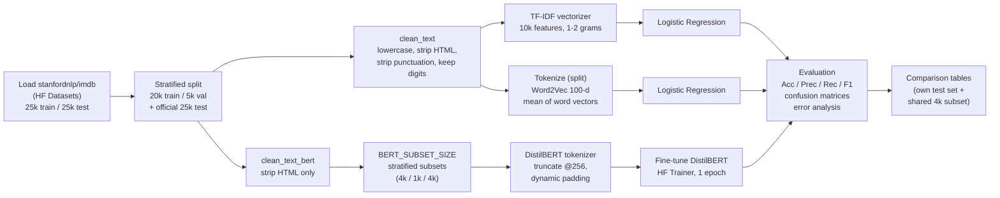

# Implementation Guide: IMDB Sentiment Analysis

This document explains the whole project in enough detail that someone with
only this repository can understand, run, modify and extend it. All numbers
below are taken from the executed notebook
(`notebooks/sentiment_analysis_imdb.ipynb`) that ships with saved outputs.

---

## 1. Purpose and Overview

**Goal:** classify IMDB movie reviews as **Positive (1)** or **Negative (0)** and
compare three ways of turning text into features:

| # | Representation | Classifier | Idea |
|---|---|---|---|
| 1 | TF-IDF (unigrams + bigrams) | Logistic Regression | Sparse word/phrase weights; fast, strong baseline |
| 2 | Word2Vec (100-d, trained from scratch, averaged per review) | Logistic Regression | Dense semantic word vectors, averaged into one review vector |
| 3 | DistilBERT (`distilbert-base-uncased`) | Built-in classification head, fine-tuned end to end | Contextual transformer that reads the whole review |

The comparison is designed to be fair:

- Every model uses the same seeded train/validation/test split.
- Nothing is fit on validation or test data.
- Every model is evaluated with the same four metrics.
- An extra table scores all three models on the exact same test reviews.

---

## 2. Pipeline



Notebook cell flow (code cells in order):

1. `%pip install` of datasets, gensim, transformers and accelerate. This is a no-op when they are already installed.
2. Imports, seeding (`random`, `numpy`, `torch`, `transformers.set_seed`), device detection.
3. Dataset loading.
4. Exploration: label distribution and one sample review per class.
5. Train/validation split.
6. Preprocessing functions, then applying them to every split.
7. Shared evaluation helpers: `evaluate_predictions`, `plot_confusion`, `show_errors`.
8. TF-IDF: fit, validate, test.
9. Word2Vec: train, build document vectors, validate, test.
10. Transformer configuration, subset selection, tokenization, model and Trainer setup, training, test prediction.
11. Confusion matrices for all three models.
12. Error analysis: up to 5 false positives and 5 false negatives per model.
13. Comparison tables.
14. Markdown analysis and conclusion, written from the actual outputs.

---

## 3. Folder and File Structure

| Path | Role |
|---|---|
| `notebooks/sentiment_analysis_imdb.ipynb` | The entire pipeline. It is saved **with outputs** from the verified local run. |
| `images/confusion_matrix_tfidf.png` | TF-IDF confusion matrix (25,000 test reviews), exported from the notebook output |
| `images/confusion_matrix_word2vec.png` | Word2Vec confusion matrix (25,000 test reviews) |
| `images/confusion_matrix_bert.png` | DistilBERT confusion matrix (4,000-review test subset). The file name is kept for compatibility. |
| `README.md` | Project summary, results, and how to run |
| `IMPLEMENTATION.md` | This document |
| `requirements.txt` | Pinned package versions that were verified to work together |
| `LICENSE` | MIT license |
| `.gitignore` | Ignores `.venv/`, `.cache/` (Hugging Face cache), `bert_imdb/` (Trainer output dir), checkpoints, `.env`, etc. |

These are created at runtime and not committed:

- `.venv/`: the virtual environment.
- `.cache/`: the Hugging Face cache, if `HF_HOME` points there.
- `notebooks/bert_imdb/`: the Trainer `output_dir`. It stays empty because `save_strategy="no"`.

---

## 4. Tech Stack (verified versions)

| Component | Version | Used for |
|---|---|---|
| Python | 3.13.5 | Runtime |
| numpy | 2.5.4 | Arrays, averaging word vectors, argmax over logits |
| pandas | 3.1.0 | Label counts, results tables |
| matplotlib | 3.11.2 | Confusion-matrix plots |
| scikit-learn | 1.9.1 | `train_test_split`, `TfidfVectorizer`, `LogisticRegression`, metrics |
| scipy | 1.18.1 | Sparse matrices (TF-IDF), gensim dependency |
| gensim | 4.4.0 | `Word2Vec` |
| torch | 2.15.0 (CPU build) | Transformer backend |
| transformers | 5.21.0 | `AutoTokenizer`, `AutoModelForSequenceClassification`, `Trainer`, `DataCollatorWithPadding` |
| accelerate | 1.15.0 | Required by `Trainer` |
| datasets | 5.1.0 | Loading IMDB; `Dataset.from_dict(...).map(...)` for tokenization |
| jupyter / ipykernel / nbconvert | 1.1.1 / 7.4.0 / 7.17.2 | Running and headless execution |

The verified hardware was Windows 11, 14 CPU cores and no GPU (`Using device: cpu`).

---

## 5. Dataset

- **Source:** `stanfordnlp/imdb` on the Hugging Face Hub, loaded with `load_dataset("stanfordnlp/imdb")`. It downloads automatically (about 85 MB) on first run. The `unsupervised` split is not used.
- **Size:** 25,000 train and 25,000 test reviews. Each split is exactly balanced: 12,500 Negative and 12,500 Positive.
- **Splits used:**

| Split | How it is made | Size | Used by |
|---|---|---|---|
| Train | `train_test_split(train, test_size=0.2, stratify=labels, random_state=42)` | 20,000 | TF-IDF, Word2Vec (full); transformer subset |
| Validation | Remaining 20% of the official train split | 5,000 | Sanity checks only (never fitted on) |
| Test | Official IMDB test split, untouched until final scoring | 25,000 | Final evaluation |

- **Transformer subsets:** controlled by one variable, `BERT_SUBSET_SIZE`. Each subset is a stratified, seeded sample made by `stratified_subset_idx`.

| `BERT_SUBSET_SIZE` | Train | Val | Test |
|---|---|---|---|
| `4000` (default, CPU) | 4,000 | 1,000 (`N // 4`) | 4,000 |
| `None` (GPU / Colab) | 20,000 | 5,000 | 25,000 |

The test-subset indices (`bert_test_idx`) are kept so TF-IDF and Word2Vec
predictions can be scored on the **same** 4,000 reviews.

---

## 6. Preprocessing

Two cleaning functions are applied identically to train, validation and test.

### `clean_text`: for TF-IDF and Word2Vec

| Step | Code | Why |
|---|---|---|
| Lowercase | `text.lower()` | "Great" and "great" become the same token, which shrinks the vocabulary |
| Strip HTML | `re.sub(r"<.*?>", " ", text)` | IMDB reviews contain `<br />` tags that are noise |
| Remove punctuation, keep digits | `re.sub(r"[^a-z0-9\s]", " ", text)` | Punctuation adds sparse noise. Digits are kept because ratings like "10/10" or "1 out of 10" carry sentiment. |
| Collapse whitespace | `re.sub(r"\s+", " ", text).strip()` | Gives clean, consistent tokens |

Stopwords are **not** removed. Words like "not" and "no" flip sentiment, and
TF-IDF bigrams such as "not good" need them.

### `clean_text_bert`: for the transformer

| Step | Why |
|---|---|
| Strip HTML only | Removes markup noise |
| Collapse whitespace | Gives clean input |
| Keep case, punctuation and stopwords | The WordPiece tokenizer and the pretrained model expect natural text. Punctuation ("!!!", "...") and negations carry meaning. |

### Tokenization

- **Word2Vec:** whitespace split (`t.split()`) of the `clean_text` output.
- **Transformer:** `AutoTokenizer.from_pretrained(BERT_MODEL_NAME)` with `truncation=True, max_length=BERT_MAX_LEN` (256). There is **no** padding at tokenization time. `DataCollatorWithPadding` pads each batch to its own longest sequence, which avoids wasting compute on pad tokens.

---

## 7. Models and Hyperparameters

### 7.1 TF-IDF + Logistic Regression

| Parameter | Value |
|---|---|
| `TfidfVectorizer.max_features` | 10,000 |
| `ngram_range` | (1, 2): unigrams + bigrams |
| Other vectorizer settings | scikit-learn defaults (`sublinear_tf=False`, `norm="l2"`, `min_df=1`) |
| `LogisticRegression.max_iter` | 1000 |
| Regularization | default L2, `C=1.0`, solver `lbfgs` |
| `random_state` | 42 |

The vectorizer is `fit_transform`ed on the training texts only. Validation and test are only `transform`ed.
The training time (14.6 s) covers fitting the vectorizer and training the classifier.

### 7.2 Word2Vec + Logistic Regression

| Parameter | Value |
|---|---|
| Architecture | CBOW (gensim default, `sg=0`) |
| `vector_size` | 100 |
| `window` | 5 |
| `min_count` | 2 (resulting vocabulary: **42,869** words) |
| `epochs` | 5 (gensim default) |
| `workers` | 1. A single thread makes training deterministic for a given seed. |
| `seed` | 42 |
| Document vector | Mean of the vectors of in-vocabulary tokens. An all-OOV review gets a zero vector. |
| Classifier | `LogisticRegression(max_iter=1000, random_state=42)` |

The training time (46.7 s) covers Word2Vec training, building the training-set document vectors, and training the classifier.

### 7.3 DistilBERT (fine-tuned)

Configuration cell variables:

| Variable | Value | Meaning |
|---|---|---|
| `BERT_MODEL_NAME` | `"distilbert-base-uncased"` | Use `"bert-base-uncased"` on a GPU for full BERT |
| `BERT_SUBSET_SIZE` | `4000` | `None` = full data |
| `BERT_EPOCHS` | `1` | Number of fine-tuning epochs |
| `BERT_MAX_LEN` | `256` | Truncation length in tokens |

`TrainingArguments` and `Trainer`:

| Parameter | Value |
|---|---|
| `per_device_train_batch_size` | 16 (giving 4,000 / 16 = **250 optimizer steps**) |
| `per_device_eval_batch_size` | 32 |
| Optimizer / LR schedule | Trainer defaults: AdamW, learning rate 5e-5, linear decay, no warmup, no weight decay |
| `eval_strategy` | `"epoch"` |
| `save_strategy` | `"no"` (no checkpoints written) |
| `logging_steps` | 50 |
| `fp16` | `torch.cuda.is_available()`, so it is enabled only on a GPU |
| `seed` | 42 |
| `report_to` | `"none"` (no W&B or other trackers) |
| Collator | `DataCollatorWithPadding` (dynamic padding) |
| Head | `AutoModelForSequenceClassification(num_labels=2)`. The `pre_classifier` and `classifier` layers are newly initialized, which is expected. |

The training time (2,464.9 s) covers only `trainer.train()`.

---

## 8. Evaluation

### Metrics

Every model goes through `evaluate_predictions`, which uses scikit-learn with Positive (1) as the positive class:

- **Accuracy:** fraction of reviews classified correctly.
- **Precision:** of reviews predicted Positive, the fraction that truly are.
- **Recall:** of truly Positive reviews, the fraction found.
- **F1-score:** harmonic mean of precision and recall.
- **Training time** and **train/test sample counts** are also recorded, so differences in data size stay visible.

The notebook also produces confusion matrices (`ConfusionMatrixDisplay`) and up to
5 printed false positives and 5 false negatives per model.

### Real results (local CPU run)

**Validation accuracy:** TF-IDF 0.8932, Word2Vec 0.8370, and DistilBERT 0.9010 (1,000 reviews; after epoch 1 its training loss was 0.2792 and validation loss 0.2722).

**Each model on its own test set**

| Model | Train | Test | Accuracy | Precision | Recall | F1 | Training time (s) |
|---|---|---|---|---|---|---|---|
| TF-IDF + Logistic Regression | 20,000 | 25,000 | 0.88932 | 0.88382 | 0.89648 | 0.89011 | 14.6 |
| Word2Vec + Logistic Regression | 20,000 | 25,000 | 0.82980 | 0.83099 | 0.82800 | 0.82949 | 46.7 |
| DistilBERT (fine-tuned) | 4,000 | 4,000 | 0.89450 | 0.88982 | 0.90050 | 0.89513 | 2,464.9 |

**Same 4,000-review test subset (apples-to-apples)**

| Model | Accuracy | Precision | Recall | F1 |
|---|---|---|---|---|
| TF-IDF + Logistic Regression | 0.88800 | 0.88189 | 0.89600 | 0.88889 |
| Word2Vec + Logistic Regression | 0.82525 | 0.82639 | 0.82350 | 0.82494 |
| DistilBERT (fine-tuned) | 0.89450 | 0.88982 | 0.90050 | 0.89513 |

**Confusion-matrix counts**

| Model | TN | FP | FN | TP | Errors |
|---|---|---|---|---|---|
| TF-IDF (25,000) | 11,027 | 1,473 | 1,294 | 11,206 | 2,767 (11.1%) |
| Word2Vec (25,000) | 10,395 | 2,105 | 2,150 | 10,350 | 4,255 (17.0%) |
| DistilBERT (4,000) | 1,777 | 223 | 199 | 1,801 | 422 (10.6%) |

### Interpretation

- DistilBERT is best on the shared subset: +0.65 accuracy points over TF-IDF and +6.9 over Word2Vec. It used one-fifth of the training data and one epoch.
- TF-IDF is nearly as accurate and about 170x cheaper to train on CPU.
- Averaged Word2Vec loses word order and dilutes sentiment words. It makes about 1.5x as many errors as TF-IDF.
- TF-IDF and DistilBERT have recall slightly above precision, so they make slightly more false positives than false negatives. Word2Vec is roughly balanced.
- **Error patterns:**
  - TF-IDF and Word2Vec misclassify many of the same reviews: hedged genre-fan reviews (a Van Damme review) and theme-praising but criticism-heavy positive reviews (Mehta's *Fire*).
  - DistilBERT's errors are mostly mixed or ironic reviews ("very good, not great but very good"; "this film isn't too bad").

---

## 9. How to Run

### 9.1 Locally (verified path)

```bash
cd imdb-sentiment-analysis-main
python -m venv .venv
# Windows (PowerShell): .venv\Scripts\Activate.ps1   Git Bash: source .venv/Scripts/activate   macOS/Linux: source .venv/bin/activate
pip install torch==2.15.0 --index-url https://download.pytorch.org/whl/cpu   # CPU wheel; omit if you want a CUDA build
pip install -r requirements.txt
```

**Interactive:** open the notebook in VS Code or Jupyter, select the `.venv` interpreter as the kernel, and click Run All.

**Headless:** this executes every cell and saves the outputs into the notebook:

```bash
python -m nbconvert --to notebook --execute --inplace --ExecutePreprocessor.timeout=7200 notebooks/sentiment_analysis_imdb.ipynb
```

Optionally, keep the Hugging Face cache inside the project, which `.gitignore` already excludes:

```bash
# Git Bash / macOS / Linux
export HF_HOME="$(pwd)/.cache/hf"
# PowerShell
$env:HF_HOME = "$PWD\.cache\hf"
```

**Expected runtime on a 14-core CPU:**

| Stage | Time |
|---|---|
| Dataset download | ~1 min |
| TF-IDF | ~15 s |
| Word2Vec | ~50 s |
| DistilBERT fine-tuning | ~41 min |
| DistilBERT test prediction | a few minutes |
| **Total** | **~52 min** |

### 9.2 GPU or Google Colab (full dataset)

1. Open Colab and use File > Upload notebook to upload `notebooks/sentiment_analysis_imdb.ipynb`. Then go to Runtime > Change runtime type and pick a GPU (for example a T4).
2. In the **Transformer configuration** cell, set:
   - `BERT_SUBSET_SIZE = None` for the full 20,000 / 5,000 / 25,000 splits;
   - optionally `BERT_MODEL_NAME = "bert-base-uncased"` and `BERT_EPOCHS = 2`.
3. Runtime > Run all. The first cell (`%pip install -q datasets gensim transformers accelerate`) installs what Colab lacks. `fp16` switches on automatically on the GPU.

The results in this repository come from the local CPU configuration only. The
full-data GPU configuration is supported by the code but has not been run for
this version.

---

## 10. Troubleshooting (issues hit while building and running this)

| Symptom | Cause | Fix |
|---|---|---|
| `FileNotFoundError: ...\.cache\huggingface\datasets\_Users_..._imdb_plain_text_0.0.0_<hash>.lock` on Windows | The `datasets` lock-file name embeds the full cache path, which pushes the total past Windows' 260-character `MAX_PATH` when the project lives in a deep folder | Point `HF_HOME` at a shorter directory (for example the 8.3 short path of the project, or `C:\hf`), or enable long paths: set `HKLM\SYSTEM\CurrentControlSet\Control\FileSystem\LongPathsEnabled = 1` (admin) |
| `jupyter nbconvert --execute` runs on the system Python instead of `.venv` | A bare `jupyter nbconvert` can dispatch to a `jupyter-nbconvert` executable found earlier on `PATH`, and the kernel then inherits that interpreter. The `%pip` cell would then install packages into the system Python. | Always run `python -m nbconvert ...` from the activated `.venv`. Check that the kernel prints the expected environment. |
| `!pip install` installs into the wrong environment locally | `!pip` runs whatever `pip` is first on `PATH` | The notebook uses `%pip`, which always targets the running kernel's interpreter |
| `UserWarning: 'pin_memory' argument is set as true but no accelerator is found` | Running the Trainer on CPU | Harmless; ignore |
| `DistilBertForSequenceClassification LOAD REPORT ... UNEXPECTED / MISSING` | The checkpoint's masked-LM head is dropped and a new classification head is created | Expected for fine-tuning; ignore |
| `Warning: You are sending unauthenticated requests to the HF Hub` | No `HF_TOKEN` set | Harmless for this public dataset and model. Setting a token only raises rate limits. |
| DistilBERT step takes ~40 min | CPU-only training | Use a GPU, lower `BERT_SUBSET_SIZE`, or lower `BERT_MAX_LEN` (for example 128) |
| CUDA out of memory with `BERT_SUBSET_SIZE=None` + `bert-base-uncased` | Batch 16 at 256 tokens on a small GPU | Lower `per_device_train_batch_size` to 8 or `BERT_MAX_LEN` to 128 |
| Colab notebook from Google Drive will not open (`ERR_CONNECTION_RESET` on drive.google.com) | Some corporate networks block Google Drive | Run locally (section 9.1) or from a network that allows Drive |

---

## 11. Limitations and Next Steps

**Limitations**

- In the shipped run the transformer saw 4,000 training reviews for 1 epoch and was scored on a 4,000-review test subset. This was a CPU-time constraint. Its margin over TF-IDF is therefore likely an underestimate. The same-subset table removes test-set differences, but not training-data differences.
- Reviews are truncated to 256 tokens. Long reviews lose their endings, and endings often hold the verdict.
- Classical models use default regularization (`C=1.0`) without tuning. The validation set is used only for sanity checks.
- Word2Vec is trained from scratch on 20,000 reviews with 5 epochs. Small-corpus embeddings are weaker than pretrained ones.
- The run uses a single seed (42). There are no confidence intervals or variance across seeds.

**Next steps**

1. Run `BERT_SUBSET_SIZE = None`, `bert-base-uncased` and 2 to 3 epochs on a GPU, and compare with the CPU subset numbers.
2. Tune TF-IDF + LR on the validation set: `C`, `sublinear_tf=True`, `min_df`, and trigrams.
3. Improve the Word2Vec aggregation: TF-IDF-weighted averaging, pretrained GloVe or fastText vectors, or a small CNN/LSTM over the word vectors.
4. Handle long reviews with head+tail truncation (first 128 + last 128 tokens) or a long-context model.
5. Report mean and standard deviation over several seeds, and add McNemar's test for significance between models.
6. Save the trained models (`trainer.save_model`, `joblib.dump`) and add a small inference script.
