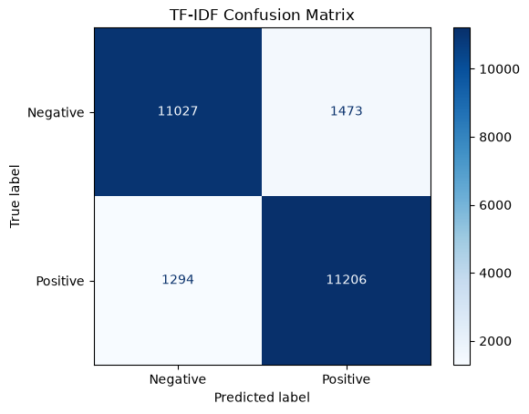
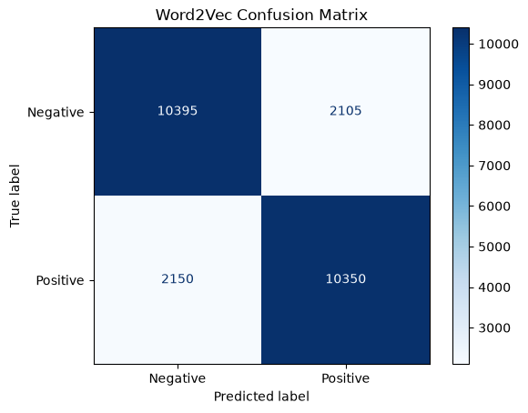
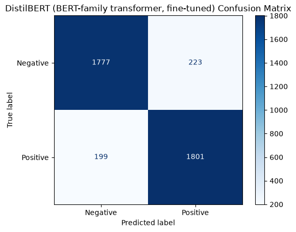

# IMDB Sentiment Analysis: TF-IDF vs Word2Vec vs DistilBERT

A side-by-side comparison of three text-representation approaches for binary
sentiment classification (Positive / Negative) on the 50,000-review IMDB movie
review dataset:

1. **TF-IDF** features + Logistic Regression
2. **Word2Vec** (averaged word embeddings, trained from scratch) + Logistic Regression
3. **DistilBERT** (`distilbert-base-uncased`, fine-tuned). Switch to `bert-base-uncased` on a GPU.

Everything lives in a single notebook, which has been executed end to end. The
saved outputs are real results, not placeholders. A fixed seed (`SEED = 42`)
is used throughout.

For a full technical walkthrough (pipeline, every preprocessing step,
hyperparameters, troubleshooting), see [IMPLEMENTATION.md](IMPLEMENTATION.md).

## Project Structure

```
imdb-sentiment-analysis-main/
├── notebooks/
│   └── sentiment_analysis_imdb.ipynb   # full pipeline, executed with outputs
├── images/                             # confusion matrices exported from the run
│   ├── confusion_matrix_tfidf.png
│   ├── confusion_matrix_word2vec.png
│   └── confusion_matrix_bert.png       # DistilBERT run
├── README.md
├── IMPLEMENTATION.md                   # detailed technical documentation
├── requirements.txt                    # pinned, verified versions
├── LICENSE
└── .gitignore
```

## Dataset

- **Source:** [`stanfordnlp/imdb`](https://huggingface.co/datasets/stanfordnlp/imdb) via Hugging Face Datasets. It has 25,000 train and 25,000 test reviews, perfectly balanced (12,500 / 12,500).
- **Split:** 20,000 train / 5,000 validation (stratified split of the official train set) / 25,000 test (official held-out test set).
- **Transformer subset:** `BERT_SUBSET_SIZE = 4000` takes stratified subsets: 4,000 train, 1,000 validation and 4,000 test reviews. This keeps CPU fine-tuning practical. Set it to `None` to use the full splits on a GPU.
- **No leakage:** the TF-IDF vectorizer, the Word2Vec model and the transformer are fit only on training data. The test set is scored once, at the end.

## Results

These come from a local, CPU-only run (Python 3.13, Windows 11, 14 cores, no GPU) using the pinned `requirements.txt`.

**Each model on its own test set**

| Model | Train | Test | Accuracy | Precision | Recall | F1 | Training time |
|---|---|---|---|---|---|---|---|
| TF-IDF + Logistic Regression | 20,000 | 25,000 | 88.93% | 88.38% | 89.65% | 0.8901 | 14.6 s |
| Word2Vec + Logistic Regression | 20,000 | 25,000 | 82.98% | 83.10% | 82.80% | 0.8295 | 46.7 s |
| DistilBERT (1 epoch, CPU) | 4,000 | 4,000 | **89.45%** | **88.98%** | **90.05%** | **0.8951** | 2,464.9 s (~41 min) |

**All three models on the same 4,000-review test subset**

| Model | Accuracy | Precision | Recall | F1 |
|---|---|---|---|---|
| TF-IDF + Logistic Regression | 88.80% | 88.19% | 89.60% | 0.8889 |
| Word2Vec + Logistic Regression | 82.53% | 82.64% | 82.35% | 0.8249 |
| DistilBERT (fine-tuned) | **89.45%** | **88.98%** | **90.05%** | **0.8951** |

Validation accuracy: TF-IDF 89.32%, Word2Vec 83.70%, and DistilBERT 90.10% (on its 1,000-review validation subset).

**Takeaways**

- **DistilBERT** is the best model on the shared test subset, at +0.65 accuracy points over TF-IDF and +6.9 over Word2Vec. It got there with one-fifth of the training data and one epoch, at roughly 170x TF-IDF's training time on CPU.
- **TF-IDF** is a strong, very cheap baseline: 88.93% on all 25,000 test reviews in 14.6 s.
- **Word2Vec** (averaged) is the weakest. Averaging vectors discards word order and dilutes sentiment words. It makes 4,255 errors vs. TF-IDF's 2,767 on the full test set.

### Confusion Matrices

| TF-IDF (25,000 test) | Word2Vec (25,000 test) | DistilBERT (4,000 test) |
|---|---|---|
|  |  |  |

| Model | False positives | False negatives | Error rate |
|---|---|---|---|
| TF-IDF | 1,473 | 1,294 | 11.1% |
| Word2Vec | 2,105 | 2,150 | 17.0% |
| DistilBERT | 223 | 199 | 10.6% |

## Error Analysis (from the printed misclassifications)

- TF-IDF and Word2Vec fail on many of the **same** reviews. For example, a hedged Van Damme fan review and the "Ben (Rupert Grint)" review are both truly Negative but predicted Positive. Both models react to the same surface vocabulary.
- **False positives** are typically hedged genre-fan reviews ("I enjoy these kinds of movies for what they are").
- **False negatives** are typically reviews that praise a theme but spend most of their text on criticism, or positive reviews with dark vocabulary (slasher, sex, killing).
- DistilBERT's remaining errors are mostly mixed or ironic reviews ("very good, not great but very good"; "this film isn't too bad").

## How to Run

### Locally (Windows / macOS / Linux)

```bash
python -m venv .venv
# Windows: .venv\Scripts\activate    macOS/Linux: source .venv/bin/activate
pip install torch==2.15.0 --index-url https://download.pytorch.org/whl/cpu   # CPU-only torch (skip for a CUDA build)
pip install -r requirements.txt
```

Then either open `notebooks/sentiment_analysis_imdb.ipynb` in VS Code or Jupyter
(select the `.venv` kernel) and Run All, or execute it headlessly:

```bash
python -m nbconvert --to notebook --execute --inplace --ExecutePreprocessor.timeout=7200 notebooks/sentiment_analysis_imdb.ipynb
```

- Use `python -m nbconvert` from the activated venv, **not** a bare `jupyter nbconvert`. A bare command can resolve to a system-wide Jupyter and run the notebook on the wrong interpreter.
- Expected CPU runtime: about 52 minutes in total, of which DistilBERT fine-tuning is about 41.
- On Windows with a long project path, the Hugging Face cache can hit the 260-character path limit. Point `HF_HOME` at a short directory, or enable Windows long paths (see IMPLEMENTATION.md).

### On a GPU or Google Colab (full dataset)

1. Upload `notebooks/sentiment_analysis_imdb.ipynb` to Colab (File > Upload notebook) and select a GPU runtime.
2. In the "Transformer configuration" cell, set `BERT_SUBSET_SIZE = None` (full 20,000 / 5,000 / 25,000). Optionally set `BERT_MODEL_NAME = "bert-base-uncased"` and `BERT_EPOCHS = 2`.
3. Runtime > Run all. The first cell (`%pip install ...`) installs the dependencies Colab is missing.

The results above come from the local CPU configuration only. A full-data GPU run
has not been executed for this version of the notebook.

## License

This project is licensed under the [MIT License](LICENSE).
